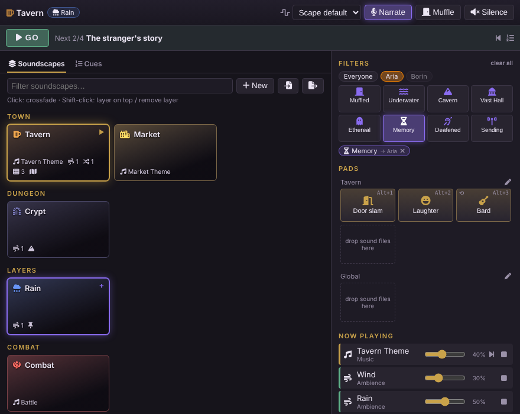
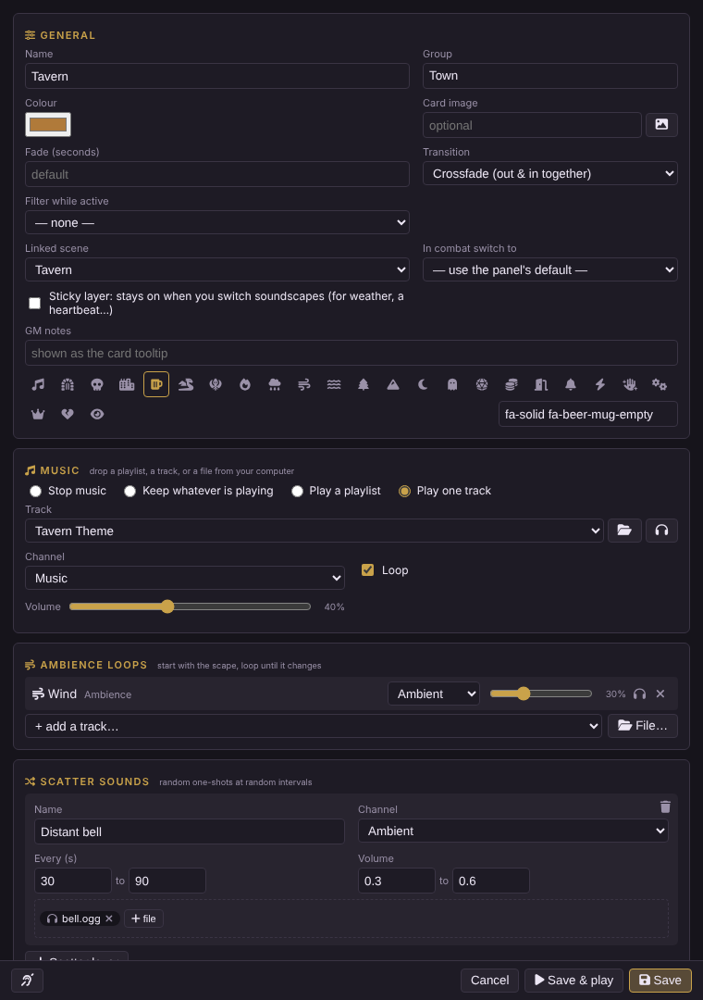
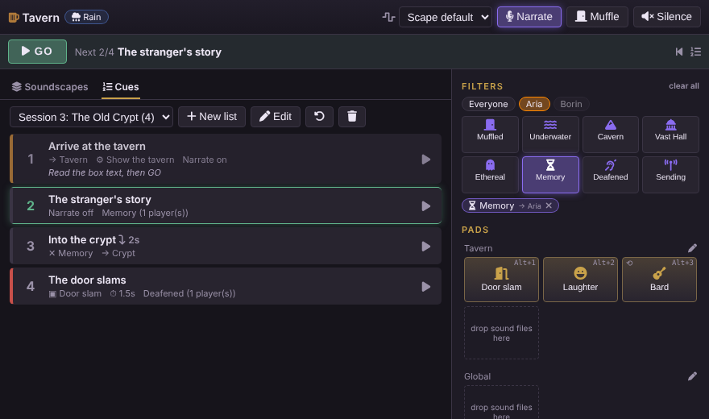
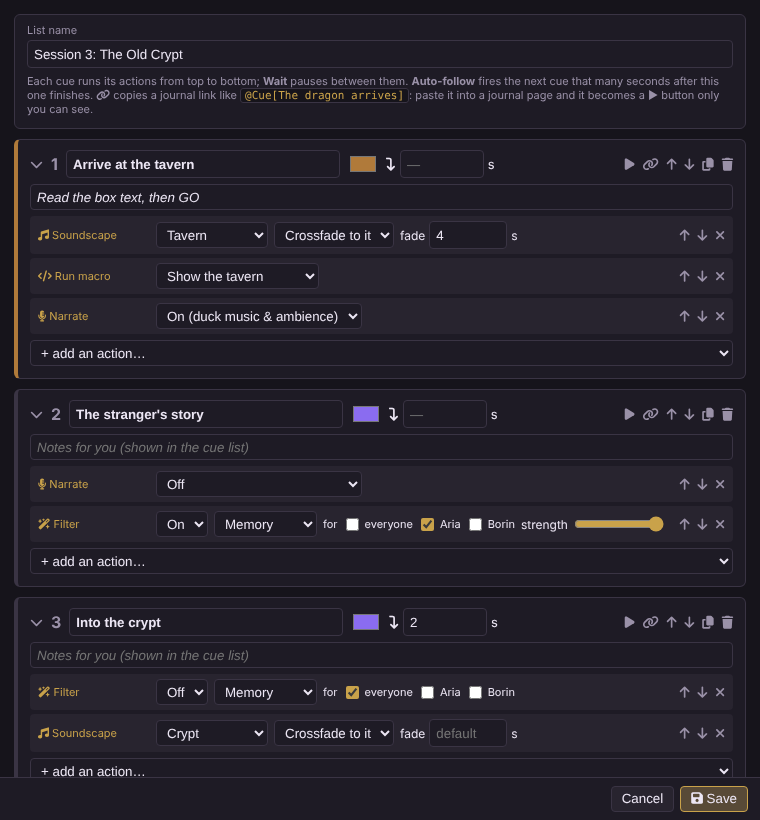

# Planar Soundboard

A GM soundboard for Foundry VTT (v14), built on your own playlists. Prepare a **soundscape** for each scene before the session, then change the mood with one click while you play: music crossfades, ambience loops come and go, and you have buttons ready for the moments you know are coming.



- **Soundscapes**: music (a track or a whole playlist), ambience loops, random scatter sounds and pads, each on the Music, Ambient or Interface channel.
- **Crossfades** between soundscapes, with sounds that two scapes share kept playing. Fade per scape, or override it for the next switch.
- **Layers**: Shift-click to put a scape on top of another (rain over the tavern); *sticky* layers survive a switch.
- **Narrate** ducks music and ambience while you read aloud.
- **Planar Filters**: eight live effects on what is already playing (Muffled, Underwater, Cavern, Vast Hall, Ethereal, Memory, Deafened, Sending), for everyone or only for chosen players.
- **Cue lists**: a session's running order. **GO** fires the next cue; `@Cue[name]` in a journal page becomes a ▶ button only the GM sees.
- **Automation**: start a scape when a scene is activated, switch to a combat scape on *Begin Combat* and back when it ends.
- **Drag and drop** sound files from your computer onto pads and sections; they are uploaded for you.
- A **macro API** for everything above.

Music and ambience play through ordinary Playlist sounds, so Foundry syncs them to every player (late joiners included) and each player's own volume sliders apply. The module ships no audio, art or text from any publisher; it plays what you give it. Interface in English and Greek.

## Install

In Foundry: **Add-on Modules → Install Module**, paste this into **Manifest URL**, and install:

```
https://github.com/zacharatos/planar-soundboard/releases/latest/download/module.json
```

Enable **Planar Soundboard** in your world. Open it with the **Soundboard** button at the top of the Playlists sidebar, or **Alt+S**.

## A soundscape

| Layer | What it does |
|---|---|
| **Music** | *Stop music*, *Keep whatever is playing*, *Play a playlist* (in that playlist's own shuffle/sequential mode), or *Play one track*. |
| **Ambience loops** | Tracks that start with the scape and loop until you switch. |
| **Scatter sounds** | Random one-shots at random intervals and volumes: a distant bell, ravens, a door somewhere. |
| **Pads** | Buttons you fire by hand. Several files on one pad play a random variant each time. **Duck** dips the music under it; **Loop** keeps it going until you click again. Right-click a pad to stop it. |

Each scape also has a colour, icon, card image, group, GM notes (the card tooltip), a fade length, a transition (*crossfade*, or *dip*: out, then in), an optional filter, a linked scene, a combat scape, and a *sticky* switch.



**Adding sounds:** drag sound files from your computer onto a section (they are uploaded to `Data/soundboard-uploads/<scape>/`), drag a playlist or playlist sound from the sidebar, use the *add a track* list, or pick a file. Music and ambience files you pick or drop are added to a playlist the module creates, **Planar Soundboard — Library**, so they still sync through Foundry. The 🎧 buttons preview a sound for you only.

## At the table

- **Click** a card to crossfade to it. **Shift-click** to layer it on top; Shift-click again removes it.
- The **fade** menu in the toolbar overrides the next switch: Cut, 0.25 s, 0.5 s, 1 s … 20 s.
- **Narrate** (Alt+N): music and ambience dip for everyone while you talk.
- **Muffle** (Alt+M): the *Muffled* filter for everyone.
- **Silence**: fade everything out.
- **Now playing**: live volume, next track and fade-out for every sound.
- **Alt+1…9**: the first nine pads of the active scapes, then the global pads (each pad shows its key).
- **Preload** (cloud icon on a card): every player starts downloading that scape's files now, one at a time, and you're warned about files that are heavy to download (`.wav`, `.flac`, over 8 MB). The next cue on the GO pointer, a scape's pads and scatter, and the pads for a player who joins are preloaded by themselves.
- **Global pads**: pads that are always there, whatever is playing.

## Planar Filters

| Filter | Sound | For |
|---|---|---|
| Muffled | high frequencies cut | behind a door, the next room |
| Underwater | heavy muffling and a slow wobble | swimming, a flooded crypt |
| Cavern | stone-room echo | caves, crypts |
| Vast Hall | long cathedral echo | a cathedral, a throne room |
| Ethereal | thin, high, ghostly echo | spirits, a voice from beyond |
| Memory | muffled, warbling, distant | flashbacks, dreams |
| Deafened | near-silence and a ringing ear, recovers by itself | a thunderclap, an explosion |
| Sending | thin "telephone" sound with crackle | magical messages, scrying |

In the **Filters** section, choose who hears it (**Everyone**, or one or more players), then click a filter to toggle it. With players chosen, only their computers apply it; everyone else, the GM included, hears normally. Filters blend in and out, and sounds that start while a filter is on get it too. The effects are built from the browser's own audio engine: no extra files.

## Cues



A **cue list** is a session's running order. Each cue runs its actions from top to bottom:
*Soundscape* (crossfade / add layer / remove layer) · *Pad* · *Filter* on or off, for everyone or chosen players · *Narrate* · *Play file* · *Run macro* · *Wait* · *Silence*.

- **GO** (the green bar, or **Alt+G**) fires the next cue; **Alt+Shift+G** steps back. Click a cue to make it the next one; its ▶ fires it straight away.
- **Auto-follow** fires the next cue by itself, N seconds after a cue finishes.
- **Journal links**: the 🔗 button in the cue editor copies `@Cue[name]`. Paste it into a journal page and it renders as a ▶ button only the GM sees. `@Cue[name]{label}` changes the text; `@Scape[name]` crossfades straight to a soundscape.



## Automation

- **Linked scene:** activating that Foundry scene starts the scape. (Clear Foundry's own *Scene → Ambience → Playlist* for that scene, or both will play.)
- **Combat:** *Begin Combat* switches to the scape's own *In combat* choice, or the panel's default. When the encounter ends, the previous scape and its layers come back.

Both can be turned off in **Configure Settings → Planar Soundboard**, next to the default fade, the narrate and pad duck levels, the muffle frequency, the upload folder, and whether a switch also fades out music you started by hand.

## Macro API

```js
PlanarSoundboard.activate("Tavern");                    // crossfade
PlanarSoundboard.activate("Crypt", { fade: 8 });         // seconds
PlanarSoundboard.toggleLayer("Rain");
PlanarSoundboard.playPad("Door slam");
PlanarSoundboard.narrate(true);                          // false, or no argument to toggle
PlanarSoundboard.muffle();
PlanarSoundboard.filter("deafened", { targets: ["Aria"] });          // character, user name or id; none = everyone
PlanarSoundboard.filter("memory", { targets: ["Alex"], intensity: 0.7, hold: 20 }); // off by itself after 20 s
PlanarSoundboard.clearFilter("memory");                  // clearFilter() turns all off
PlanarSoundboard.cue("The door slams");                  // fire a cue by name
PlanarSoundboard.go();                                   // next cue of the current list
PlanarSoundboard.stopAll({ fade: 5 });
PlanarSoundboard.play("sounds/thunder.ogg", { volume: 0.9, channel: "environment" });
PlanarSoundboard.open();
```

The same object is `game.modules.get("planar-soundboard").api`. Hooks for other modules: `planar-soundboard.activate` (scape, `{additive}`), `planar-soundboard.fxChanged`, `planar-soundboard.cuesChanged`.

## Backup

Soundscapes and cue lists are stored in world settings. **Export** in the panel saves both as JSON; **Import** merges a file back (same id = replaced). They refer to your playlists, so an export is meant for the same world, or one with the same playlists.

## Development

`npm test` runs the syntax check and the tests (no Foundry needed). See [docs/DEVELOPMENT.md](docs/DEVELOPMENT.md) for the file map and the manual test checklist, and [docs/PUBLISHING.md](docs/PUBLISHING.md) for releases. Changes are listed in [CHANGELOG.md](CHANGELOG.md).

## License

[MIT](LICENSE)
